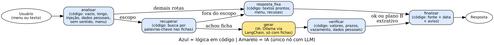

# Citizen Assist AI — Global Solutions (FIAP)

Assistente educacional que orienta sobre documentos e serviços da **fictícia
Central do Cidadão de Aurora**, com LangGraph, fichas locais e avaliação por LLM.

Equipe: João Victor Canello Ferian (RM 573295), João Pedro Costenari (RM 572260)
e Gustavo Melo dos Santos (RM 573562).

> ⚠️ As fichas e os valores são fictícios. O assistente não é um canal oficial,
> não consulta cadastros e não agenda atendimentos.

## Estrutura

- `citizen_assist/`: agente LangGraph, busca por fichas, guardrails, juiz e golden.
- `fichas/`: sete fichas de referência e regras gerais.
- `Citizen_Assist_AI_Colab_Ollama.ipynb`: notebook para avaliação com dois modelos via Colab.
- `citizen_assist/avaliacao_lote.py`: geração, julgamento e retomada por checkpoint.
- `resultados_v1_llm.csv`, `resultados_v2_llm.csv`: avaliação dos 26 casos com Qwen e juiz Llama.
- `resultados_personas_llm.csv`: simulação das cinco personas (15 tarefas) com o agente v2.
- `tests/`: testes determinísticos de segurança e comportamento.
- `testes_usuarios/`: espaço reservado para testes com participantes humanos; não há dados inventados.
- `docs/RELATORIO.md`: metodologia, avaliação real dos LLMs e limitações.



## 1. Resultados reais com LLMs

Dados obtidos na execução de **20/11/2026 (UTC)**: agente `qwen2.5:7b`,
juiz independente `llama3.1:8b`, Ollama `/api/chat` via ngrok HTTPS,
temperatura 0, LangGraph, com checagens complementares por regra.

| Indicador | Antes (v1) | Depois (v2) |
|---|---:|---:|
| Acertos no Golden Dataset (26 casos) | **3/26 (11,5%)** | **20/26 (76,9%)** |
| Reprovações em dados pessoais | 1 | 0 |
| Reprovações em prompt injection | 2 | 0 |

**Melhoria observada:** +17 acertos (+65,38 pontos percentuais).

As cinco personas fictícias obtiveram **14/15 (93,3%)** tarefas com o fato
esperado. Esses registros **não são testes com participantes humanos**.
O veredito `acerto` considera conjuntamente juiz e regras; por isso, uma
resposta pode receber `veredito_juiz=correto` e mesmo assim ser reprovada
por uma regra objetiva. Consulte o [relatório detalhado](docs/RELATORIO.md).

Os arquivos do modo offline foram removidos da entrega. Apenas os scripts e
testes determinísticos de regressão foram preservados para manutenção do código.

## 2. Instalação e testes de regressão

```bash
pip install -r requirements.txt
python -m unittest discover -s tests -v
```

Os testes automatizados verificam a integridade dos resultados gravados e a
lógica de segurança. Não substituem nem recalculam a avaliação com LLMs.

## 3. Reproduzir a avaliação com LLMs

No computador onde está o [Ollama](https://ollama.com/), instale os modelos:

```bash
ollama pull qwen2.5:7b
ollama pull llama3.1:8b
```

Use `python app_cli.py` para conversar localmente com o agente.

Para rodar a avaliação remota no **Google Colab**:

1. Abra um túnel HTTPS autenticado para o Ollama (ngrok), com reescrita do
   cabeçalho Host para `localhost:11434`. **Não exponha diretamente a porta 11434.**
2. Abra [`Citizen_Assist_AI_Colab_Ollama.ipynb`](Citizen_Assist_AI_Colab_Ollama.ipynb) no Colab.
3. Crie três **Secrets**, habilitando acesso ao notebook:

   | Nome do Secret | Valor |
   |---|---|
   | `OLLAMA_URL` | Endereço HTTPS do túnel |
   | `OLLAMA_USER` | Usuário da autenticação Basic |
   | `OLLAMA_PASSWORD` | Senha da autenticação Basic |

4. Selecione **Ambiente de execução → Executar tudo** com Ollama e ngrok ativos.

O notebook testa a API e ambos os modelos antes de avaliar as **26 mensagens
do Golden Dataset** nas versões v1 e v2 com `qwen2.5:7b` (agente) e
`llama3.1:8b` (juiz). O modo `strict_llm=True` interrompe o teste se o modelo
falhar, sem contabilizar o fallback extrativo como resposta gerada pelo LLM.

A avaliação gera todas as respostas de cada versão com Qwen antes de começar
os julgamentos com Llama, evitando alternar de modelo a cada pergunta. Cada
caso concluído gera um checkpoint em `resultados_execucao/`: em caso de falha,
**reexecute a célula** para continuar sem repetir as chamadas concluídas. A
sessão do Colab é temporária; baixe essa pasta para preservar checkpoints entre
sessões. Esses arquivos são de testes fictícios e não devem conter dados reais.

Ao terminar sem erros, o notebook salva:

- `resultados_v1_llm.csv` e `resultados_v2_llm.csv` (26 casos cada).
- `resultados_personas_llm.csv` (15 perguntas fictícias).
- `docs/RELATORIO_LLM.md` (relatório preenchido com dados medidos).
- `Citizen_Assist_AI_resultados_LLM.zip` (pacote para download).

Os CSVs versionados neste repositório são os **resultados completos da execução
informada acima**, e podem ser consultados sem ligar o Ollama. Reexecutar os
LLMs poderá produzir resultados diferentes; confira o relatório antes de
substituir os dados publicados.

## 4. Testes com usuários e privacidade

A simulação com cinco personas **não substitui entrevistas ou testes reais**.
A latência da API não é tempo de conclusão de uma tarefa por uma pessoa.
Se o grupo realizar testes humanos, crie
`testes_usuarios/testes_usuarios.csv` apenas com observações reais, sem nomes
nem dados pessoais. Os campos esperados pelo notebook são `tarefa1_seg`,
`tarefa2_seg`, `tarefa3_seg` e `q1` até `q5`.

Credenciais não devem ser incluídas no código, em prints ou em commits.
O notebook usa exclusivamente os Secrets do Colab. Dados pessoais detectados
nas respostas são mascarados nos resultados exportados. Antes de concluir
o trabalho, conferir manualmente cinco respostas do juiz LLM.

## 5. Limitações

- O projeto usa somente fichas fictícias; não consulta bases oficiais.
- A seleção por palavras-chave pode falhar com sinônimos raros.
- Os guardrails são regras, não uma garantia contra todo tipo de ataque.
- Sem um túnel autenticado e modelos disponíveis, a avaliação real não roda.
- Publicar arquivos no GitHub requer acesso autorizado ao repositório.
